Lithography, layout, process and yield, as open tools. Research assistant at IMT, KIT.

[LinkedIn](https://www.linkedin.com/in/sebastian-kallfelz-9b86913b0) &nbsp;·&nbsp; [blade26@web.de](mailto:blade26@web.de)
